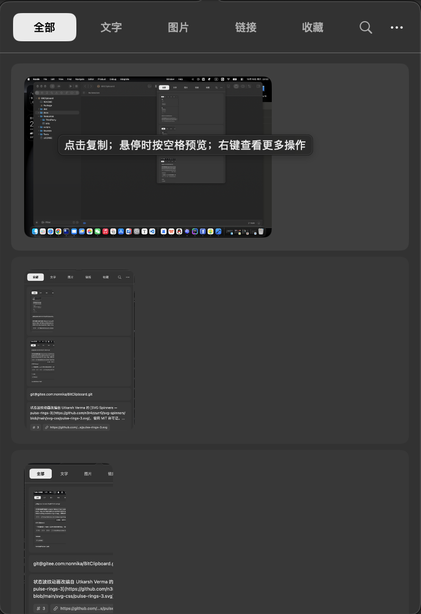

# BitClipboard

> 感受 MacOS 上轻量极致的剪切板体验




## 特点

- 智能提取 URL 数字等信息
- 空格预览
- Google EmbeddingGemma 2 本地自然语言语义搜索，结合关键词匹配与相关度排序

## 构建与使用

```bash
bash scripts/build.sh
open dist/BitClipboard.app
```

按 ⌘F 输入关键词或自然语言描述，例如“关于会议安排的内容”“数据库连接报错”。输入“图片 / 照片 / 截图”“链接 / 网址”“文字 / 文本”会直接筛选记录类型。文字与链接支持语义检索，图片也可按来源应用搜索。收藏与分类筛选继续生效；搜索时优先展示关键词命中，再按语义相关度排序，无搜索词时仍按收藏和时间排序。

在设置 →「自然语言语义搜索」中点击「下载并安装模型」。设置会显示安装阶段、下载百分比与已下载 / 总字节数；运行组件显示当前组件进度，模型文件显示整体进度。关闭设置后下载继续进行，重新打开可查看当前进度。失败后可查看安装日志并重试。

也可直接运行：

```bash
bash Sources/BitClipboard/SemanticRuntime/setup.sh
```

需要 Python 3.10–3.14（Homebrew 或 python.org）。首次安装从 PyPI 安装隔离的 Python 运行环境，并从 Hugging Face 下载 [Google EmbeddingGemma 2](https://huggingface.co/google/embeddinggemma-2)，需要预留数 GB 磁盘空间。安装失败可在设置中查看日志并重试。运行环境与模型保存在 `~/Library/Application Support/BitClipboard/SemanticSearch`；应用构建包含启动脚本，模型独立于应用升级。

搜索采用仅文字编码器、CPU float32、256 维归一化向量，并使用模型推荐的 SearchQuery 和 `title: none | text:` 文档前缀（剪贴板内容没有文档标题，来源应用仅参与关键词匹配）。首次搜索会建立历史向量索引，后续复用本地缓存；长文本按 1,600 字符分段并保留重叠，每条最多处理前 24,000 字符。语义匹配使用 0.72 的余弦相似度下限，并只保留距最高分不超过 0.06 的候选；关键词命中始终保留。查询最多处理前 2,000 字符。

当前模型对“代码 / code”等短类别查询存在误匹配和漏召回，调整分数阈值不能解决错误排序。普通描述检索的少量集成测试不能代表总体准确性；详见[模型诊断与可复现对照评测](docs/search-model-evaluation.md)。

历史记录与向量缓存都保存在本机，删除历史会同步清理对应缓存。安装完成后，模型加载与搜索强制离线，不上传剪贴板或搜索词。模型未安装、关闭或推理失败时，自动使用关键词搜索。设置可以关闭语义搜索以释放模型进程。

开发时可以将运行环境装在仓库内，启动时通过环境变量指定：

```bash
bash Sources/BitClipboard/SemanticRuntime/setup.sh "$PWD/.build/semantic-runtime"
BITCLIPBOARD_SEMANTIC_RUNTIME="$PWD/.build/semantic-runtime" swift run BitClipboard --show
```

运行测试：`bash scripts/test.sh`（Swift 搜索 / 安装事件流测试及 Python 下载进度测试）。可通过 `BITCLIPBOARD_TEST_RUNTIME` 指定已安装的运行环境来执行真实模型集成测试（默认跳过）；安装了 `huggingface_hub` 时也会检查实际 Xet 进度回调。

